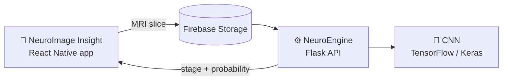

# NeuroEngine 🧠

REST API that classifies **brain MRI images into four Alzheimer's disease stages** with a convolutional neural
network built in **TensorFlow / Keras**. It is the backend of
[NeuroImage Insight](https://github.com/CuencaOscar/NeuroImage-Insight), the mobile app developed for my thesis
*"Desarrollo de una aplicación móvil para clasificación de imágenes de Alzheimer mediante aprendizaje automático"*
at Universidad Técnica de Machala (UTMACH).


> **Research project, not a medical device.** The results must not be used to diagnose or treat anyone.

<p align="center"></p>
<p align="center"><sub>The <a href="https://github.com/CuencaOscar/NeuroImage-Insight">NeuroImage Insight</a> mobile app, powered by this API.</sub></p>

## How it works



1. The app uploads the MRI slice (or sends it directly to the API).
2. The API validates the image, converts it to RGB 128×128, scales it to [0, 1] and runs the model loaded in memory.
3. It returns the most likely stage, or every stage with its probability.

## Model

| | |
|---|---|
| Architecture | Sequential CNN: 3 convolution + pooling blocks, dense 128 → 64 → 4 (softmax) |
| Input | 128×128 RGB |
| Classes | `Mild_Demented`, `Moderate_Demented`, `Non_Demented`, `Very_Mild_Demented` |
| Dataset | Alzheimer's MRI dataset (Kaggle), 6,400 axial slices — not redistributed here |
| Sanity check | 32/32 correct on sample slices from the dataset (`scripts/predict.py`) |

The sample check uses images from the original dataset, so it confirms the pipeline works end to end; it is not an
independent accuracy estimate. The trained model is published as a
[GitHub release](https://github.com/CuencaOscar/NeuroEngine/releases) instead of living in the repository.

## Research

`research/` contains the experiments that preceded the final model: feature extraction, PCA, LDA, SVMs with
linear, polynomial and RBF kernels, and a VGG16 transfer-learning baseline. Metrics, confusion matrices and ROC
curves for each one are in `research/results/`.

| Experiment | Task | Test accuracy |
|---|---|---|
| SVM, linear kernel | 4 stages | 99.61 % |
| LDA | Demented vs. non-demented | 88.12 % |

To reproduce them, download the dataset and point `NEUROENGINE_DATASET_DIR` to the folder that holds one
sub-folder per class:

```bash
pip install -r requirements-research.txt
NEUROENGINE_DATASET_DIR=/path/to/Dataset python research/main.py
```

## API

### `GET /health`
```json
{ "status": "ok", "service": "neuroengine", "version": "1.0.0" }
```

### `POST /api`
Send the image in the `image` field, either as a **multipart file** or as an **HTTPS URL** from an allowed host
(Firebase Storage by default). Returns the most likely stage (format used by the mobile app):

```bash
curl -F "image=@scan.jpg" http://localhost:8000/api
```

```json
{ "Very_Mild_Demented": "99.97%" }
```

### `POST /api/v2/classify`
Same input; returns every stage sorted by probability:

```json
{
  "predictions": [
    { "label": "Very_Mild_Demented", "probability": 99.97 },
    { "label": "Mild_Demented", "probability": 0.02 },
    { "label": "Non_Demented", "probability": 0.01 },
    { "label": "Moderate_Demented", "probability": 0.0 }
  ]
}
```

Invalid files, oversized images and URLs from non-allowed hosts are rejected with `400`.

## Getting started

```bash
python -m venv .venv && source .venv/bin/activate   # Windows: .venv\Scripts\activate
pip install -r requirements.txt
cp .env.example .env
python scripts/download_model.py
flask --app wsgi run --port 8000
```

Classify a local image:

```bash
python scripts/predict.py scan.jpg
```

### Docker

```bash
docker build -t neuroengine .
docker run -p 8000:8000 neuroengine
```

## Configuration

| Variable | Default | Description |
|---|---|---|
| `MODEL_PATH` | `models/alzheimer-classifier.h5` | Path to the trained model |
| `ALLOWED_IMAGE_HOSTS` | `firebasestorage.googleapis.com` | Comma-separated hosts allowed for image URLs |
| `MAX_IMAGE_BYTES` | `10485760` | Maximum image size (10 MB) |
| `DOWNLOAD_TIMEOUT` | `10` | Seconds to wait when downloading an image URL |

## Development

```bash
pip install -r requirements-dev.txt
ruff check . && ruff format --check .
pytest
```

Tests use a fake predictor, so they run without TensorFlow or the model file. CI runs lint and tests on every push.

## Project structure

```
neuroengine/
├── __init__.py        # Flask application factory and routes
├── config.py          # Settings from environment variables
├── images.py          # Safe image loading (upload or allowed URL)
└── predictor.py       # Preprocessing and Keras inference
research/              # Experiments (PCA, LDA, SVM, VGG16) and their results
scripts/               # Model download and CLI prediction
tests/                 # API and preprocessing tests
```

## License

MIT © Oscar Cuenca · [LinkedIn](https://www.linkedin.com/in/ocuenca-moreno/)
